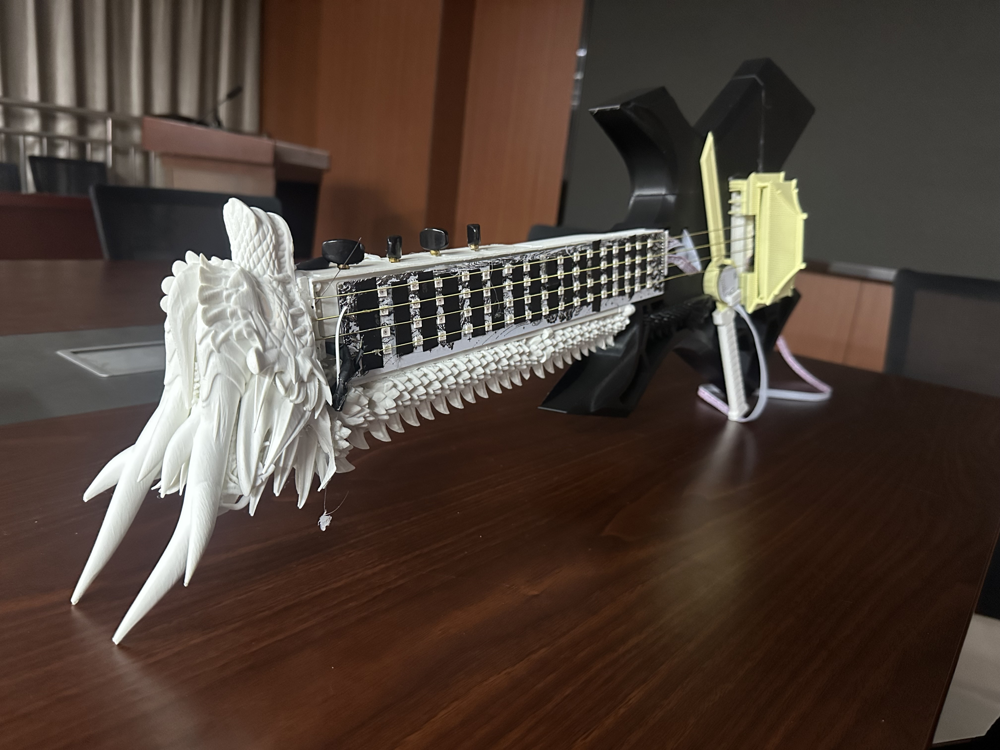
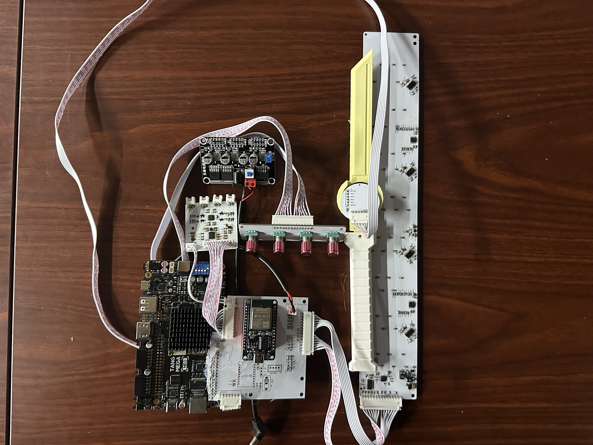
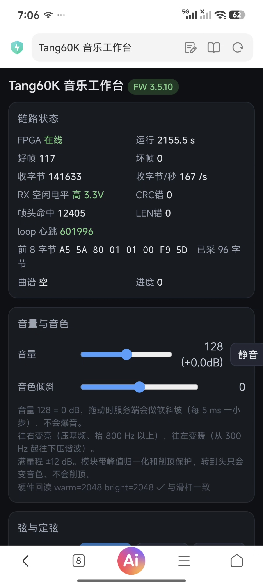
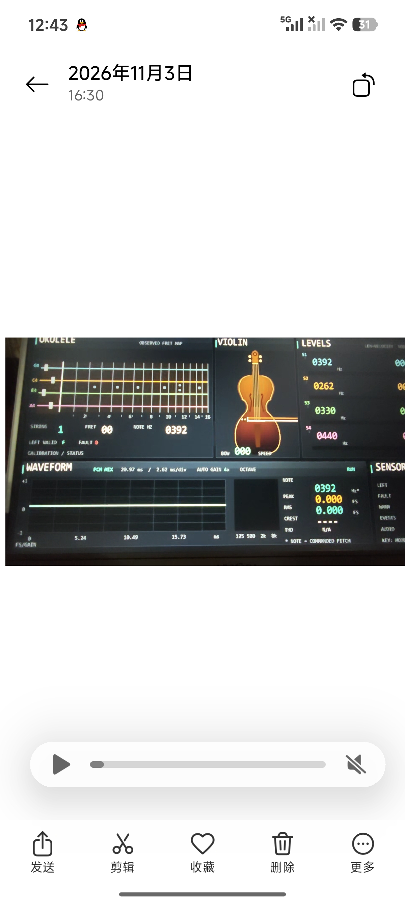

# Tang Mega 60K MUSIC

> 用 FPGA 实时合成小提琴与尤克里里，用真实琴弓与按品动作演奏的弦乐器。
> 右手光学传感器测弓速/弓位 + 压电拾音选弦；左手电极板检测按品；
> ESP32 提供 WiFi 工作台与曲谱指引；HDMI 输出 720p 舞台画面。

**发布位流：R54** ｜ **源码版本：R54** ｜ **固件：3.5.10**

[许可](LICENSE) · [第三方声明](NOTICE) · [更新日志](CHANGELOG.md) · [版本历史](docs/version-history.md)

> ⚠️ **本仓库不是 OSI 开源项目。** 采用「非商业免费 + 专利保留」许可：
> 个人学习与研究免费，**商业使用需书面授权**，且**不授予任何专利许可**。
> 详见 [LICENSE](LICENSE) 第三条。

---

## 一、这是什么

一个可以真的"拉"的电子乐器。不是 MIDI 控制器，是**物理模型合成 + 真实演奏动作**：

- 琴弓上装光学传感器，弓速决定音量、弓压决定音色、弓位决定明亮度；
- 4 路压电拾音器贴在弦上，靠起音瞬态判断"哪根弦被拉响"；
- 左手电极板检测按品位置（16 通道 ADC + 载波激励）；
- 8 条弦（小提琴 4 + 尤克里里 4）各自独立的波导合成器，在 FPGA 内实时运行；
- 曲谱只做**视觉指引**，不自动播放——演奏者控制一切。

从零到 62 个位流版本的迭代记录见 [`docs/version-history.md`](docs/version-history.md)。

---

## 二、实拍

| 成品外观 | 整机装配 |
|---|---|
|  |  |

| 工作台（固件 3.5.10） | HDMI 舞台画面 |
|---|---|
|  |  |

更多实拍与实板证据见 [`docs/images/`](docs/images/)。

---

## 三、核心特性

| 能力 | 实现要点 |
|---|---|
| 8 弦独立发声 | 4 小提琴（弓弦）+ 4 尤克里里（拨弦），各自独立波导与包络 |
| 弓弦控制 | 弓速→音量、弓压→音色、弓位→明亮度，离弦即静音 |
| 压电选弦 | 4 路 AD7091R-4，起音上升速度判据（非比值判据），抗静止误触发 |
| 左手按品 | 双片 ADC128S102（16 通道）+ 260.4 kHz 载波激励，多品取最高 |
| 实时合成 | 48,828.125 Hz 采样，演奏延迟 4.02 ms（三通道：0.68 / 0.40 / 4.02 ms） |
| HDMI 显示 | 720p：琴颈品位图、弓位示意、4 通道波形、8 倍频程频谱、参数面板 |
| 曲谱指引 | 网页上传 MIDI → LittleFS 4 槽 → 屏幕按品/按弦高亮（不发声） |
| WiFi 工作台 | ESP32 热点 + 网页：调音、音量、音色、混响、曲谱上传、接线自检 |
| 物理面板 | 4×EC11：音量 / 音色 / 定弦 / 混响，长按复位 |

---

## 四、系统架构

```
         ┌────────────── Tang Mega 60K (GW5AT-LV60PG484AC1/I0, 50 MHz) ─────────────┐
         │                                                                          │
  弓 ───►│ PAW3395 ──SPI──► bow_motion_tracker ──┐                                  │
         │                                        ├─► 8× 波导合成 ──► PT8211 ──► DAC │
  弦 ───►│ 4× 压电 ──► AD7091R-4 ──► piezo_vote ─┤        │                          │
         │                                        │        └─► r9_audio_monitor       │
  左手 ─►│ 电极板 ─► 载波激励 ─► ADC128S102×2 ─► left_hand_* ─┘          │           │
         │                                                              ▼           │
         │  UART2 230400 ◄──► ESP32（WiFi 网页 / 曲谱 / 4×EC11）   HDMI 720p 舞台画面 │
         └──────────────────────────────────────────────────────────────────────────┘
```

控制链路（网页 → ESP32 → FPGA 的寄存器路径）见 [`docs/control-path.md`](docs/control-path.md)。

---

## 五、仓库结构

```
.
├── README.md               本文件
├── LICENSE                 非商业许可（含专利保留条款）
├── NOTICE                  第三方组件与商标声明
├── CHANGELOG.md            里程碑版本
├── releases/R54/           发布位流 + 固件 + 校验和 + 烧录说明
├── fpga/                   FPGA 源码（RTL / 约束 / 配置 / Gowin 工程）
│   ├── src/                93 个文件，含 src/rom/ 的 9 个 ROM
│   ├── constraints/        .cst 引脚 + .sdc 时序（唯一权威）
│   └── config/             左手检测参数 JSON（生成 .vh 的真源）
├── firmware/               ESP32 固件（PlatformIO 工程）
│   ├── src/                main / link_v2 / score_v2 / web_ui / encoder_panel
│   ├── tools/              flash_tool.py 烧录工具
│   └── docs/               曲谱格式、烧录指南、UART 改造指南
├── hardware/               硬件设计与验证
│   ├── boards/             5 块自研板（.epro2）+ 3 份原理图 PDF
│   ├── bow-module-3d/      琴弓模块 3D 结构（OpenSCAD 参数化）
│   ├── pinout.md           引脚表（含 EC11 实测反推过程）
│   └── wiring.md           外设清单与接线
├── docs/                   设计文档、验证记录、图片
└── tools/                  构建、回归、仿真
    ├── build/              构建脚本
    ├── regression/         回归与仿真运行器
    └── sim/                115 个 testbench
```

---

## 六、快速开始

### 6.1 只想听声音（约 5 分钟）

1. **烧位流**：Gowin Programmer → `releases/R54/R54-bitstream.fs`，器件 `GW5AT-60B`，
   Operation 选 **External Flash Mode**，勾 Verify；
2. **烧固件**：
   ```bash
   cd firmware
   python tools/flash_tool.py --list        # 找 CH340（1A86:7523），排除 FT2232H
   python tools/flash_tool.py --bin "../releases/R54/firmware_3.5.10.bin" --yes
   ```
3. 断电重上电，接 HDMI 与音频输出，拨弦或拉弓。

详细步骤与故障排查见 [`releases/R54/README.md`](releases/R54/README.md)。

> 位流与固件**必须成对烧**。R54 位流配 3.5.10 固件（3.5.8 引脚表反序，四旋钮会错位）。

### 6.2 从源码构建 FPGA

环境：Gowin EDA V1.9.12.03、Python 3.11+。

```bash
cd fpga
python ../tools/build/build_batch.py --place 2 --jobs RX --early-copy ../out
```

成功判据：日志出现 `Bitstream generation completed`。
`gw_sh` 写完常以非零码退出（3221226505/127），产物齐全 + 0 ERROR 即为成功。

### 6.3 从源码构建固件

```bash
cd firmware
pio run -e esp32dev
pio run -e esp32dev -t upload
```

### 6.4 跑回归

```bash
cd tools/regression
powershell -NoProfile -ExecutionPolicy Bypass -File run_physical_regression.ps1
```

6 组：left / adc / control / pitch / piezo / bank。
八声部集成用例末尾的 `FAIL ... preserves independent pluck velocities` 是**预期失败**（历史遗留断言）。

---

## 七、硬件

| 外设 | 型号 | 接口 |
|---|---|---|
| 主控 | Tang Mega 60K · GW5AT-LV60PG484AC1/I0 | 50 MHz |
| 弓传感器 | PAW3395 | SPI |
| 压电采集 | AD7091R-4（4 通道） | SPI |
| 左手采集 | ADC128S102 ×2（16 通道） | SPI mode-3 + 载波激励 |
| 音频 DAC | PT8211 | I2S |
| 显示 | HDMI 720p（Dock J29） | DVI/TMDS |
| 上位机 | ESP32 | UART2 230400，**必须共地** |
| 面板 | EC11 ×4 | GPIO |

引脚以 [`hardware/pinout.md`](hardware/pinout.md) 与 `fpga/constraints/tang_mega_60k.cst` 为准。
自研板卡的 EDA 工程在 [`hardware/boards/`](hardware/boards/)（`.epro2` 用**嘉立创 EDA 专业版**打开）。

---

## 八、文档

| 想了解 | 看 |
|---|---|
| R54 改了什么、验证了什么 | [`docs/release-notes-R54.md`](docs/release-notes-R54.md) |
| 网页如何控制 FPGA | [`docs/control-path.md`](docs/control-path.md) |
| 每个版本做了什么、为什么废弃 | [`docs/version-history.md`](docs/version-history.md) |
| 左手采集链的延迟与信噪比依据 | [`docs/left-hand-latency.md`](docs/left-hand-latency.md) |
| 板级验证记录 | [`docs/board-validation.md`](docs/board-validation.md) |
| 源码与位流的版本差异 | [`fpga/README.md`](fpga/README.md) |
| 硬件调试（灯板、ADC 原码） | [`hardware/left-panel-validation.md`](hardware/left-panel-validation.md) |

---

## 九、已知限制

1. **R54 源码是按版本记录逐文件还原的**（原始整目录快照在迭代中被覆盖）。还原方法与
   每个文件的依据见 [`fpga/README.md`](fpga/README.md)，已通过 ModelSim 全量编译与
   R54 自带 testbench 验证；但**未重跑 PnR**，综合资源数不保证逐位相同。
2. **R54 的 paw3395 驱动带 MOT=0 缺陷**：传感器报"本轮无位移"时不清 delta，
   会把上次位移当新样本，极端情况下某根弦持续自鸣。该缺陷在 R59 修复，本仓库保留 R54 原状。
3. **时序裕量偏紧**：R54 hold 约 0.168 ns，属该设计的固有临界路径（选弦链）。可上板，但不宜再加逻辑。
4. **资源红线**：CLS < 88%、BSRAM 余量 ≥ 10 块。R54 实测 CLS 84%、BSRAM 余 14。
5. **DDR3 不可用**：PLL 与全局时钟资源已满，波形缓存只能用 BSRAM。
6. **长时间演奏未做老化测试**。

---

## 十、版本说明（重要）

| 项 | 版本 | 位置 |
|---|---|---|
| 发布位流 | **R54** | `releases/R54/R54-bitstream.fs` |
| 源码 | **R54** | `fpga/src/`（91 文件 + 9 个 ROM） |
| 固件源码 | **3.5.13** | `firmware/src/` |
| 配套固件 | **3.5.8**（或 3.5.10） | `releases/R54/` |

**本仓库的位流与源码是同一个版本（R54）**，二者可直接对应。

R54 之后项目又迭代了 R55~R62b。早期采用「单份 `src/` 演进 + 发布目录只存位流」的方式，
R54 的整目录快照在当天后续迭代中被覆盖，因此本仓库的 R54 源码是**按版本记录逐文件还原**的：
其中 8 个文件取自 R55 源码快照与 R53 备份（有哈希与文档双重佐证），
其余按各版本改动文档逐项回退。完整依据表见 [`fpga/README.md`](fpga/README.md) 第二节。

- 想直接演奏 → 用 `releases/R54/`；
- 想改代码 → 基于 `fpga/src/`（R54）构建。若需要 R59 之后修复的 MOT=0 缺陷修复，
  参见 [`docs/version-history.md`](docs/version-history.md) 的 R59 条目。

---

## 十一、许可与专利

**本项目采用「非商业免费 + 专利保留」许可，不是 OSI 开源许可。**

| 场景 | 是否允许 | 需要什么 |
|---|---|---|
| 个人学习、兴趣实践 | ✅ | 保留版权声明与本协议 |
| 课堂教学、学术研究 | ✅ | 同上 |
| 修改、二次开发（非商业） | ✅ | 标注修改，衍生作品同样许可 |
| 商业产品、付费服务、企业内部生产 | ❌ | **书面授权**（著作权 + 专利双重许可） |
| 声称获得专利许可 | ❌ | 本协议不授予任何专利许可 |

- 完整条款：[`LICENSE`](LICENSE)（中文作准，附英文摘要）；
- **专利权明确保留**：本协议仅授予著作权许可，不授予任何明示或默示的专利许可。
  许可人保留就左手电极采集与判决方法、压电选弦判据、弓速/弓压映射、
  波导合成与琴体共振结构、链路协议与曲谱指引机制等技术方案申请与行使专利权的全部权利。
- 商业授权联系（任一均可）：**`jingchunqi09@gmail.com`** ｜ **`1653020654@qq.com`** ｜ **`3610810017@qq.com`**

第三方组件（Gowin DVI IP、Arduino-ESP32 等）不在上述许可范围内，见 [`NOTICE`](NOTICE)。

---

## 十二、致谢

Gowin EDA、Arduino-ESP32、PlatformIO、ModelSim。
以及在本项目 62 个版本的迭代中提供评审意见的多个大模型。
